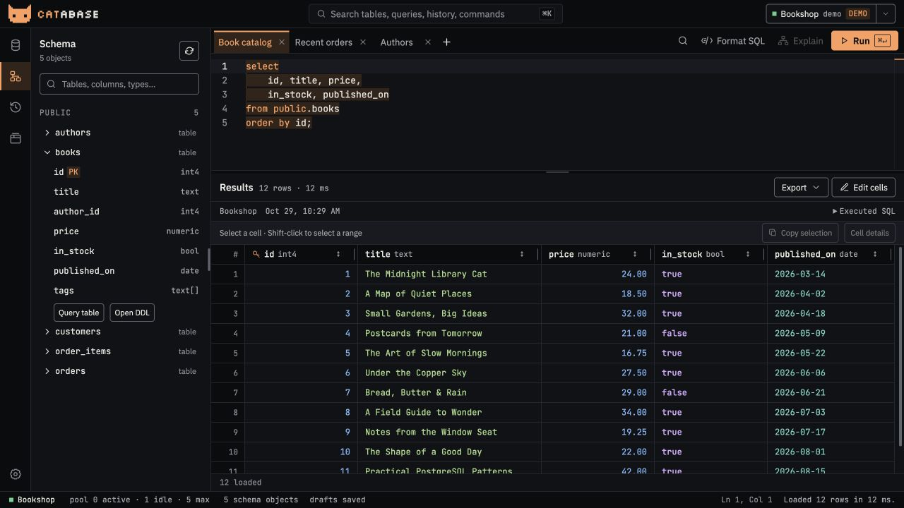

<p align="center"></p>
<h1 align="center">Catabase</h1>
<p align="center">A desktop PostgreSQL workspace. Write SQL, explore data, review changes.</p>
<p align="center"><a href="https://github.com/smolijar/catabase/actions/workflows/ci.yml"></a></p>



*Real UI, fictional bookshop data.*

- **SQL editor:** schema-aware completion, foreign-key joins, formatting and find/replace.
- **Data grid:** typed values, JSON/arrays, paging, CSV/TSV/JSON exports and reviewed cell edits.
- **Workspace:** saved connections and tabs, global search, transaction history and query timings.
- **Make it yours:** light/dark themes, connection accents, resizable panels and editor font zoom.

## Install · macOS

Apple Silicon and Intel, one universal app:

```sh
curl -fsSL https://raw.githubusercontent.com/smolijar/catabase/main/install.sh | sh
```

Installs into `~/Applications` without sudo. Quit Catabase before reinstalling. Or download the DMG from [Releases](https://github.com/smolijar/catabase/releases/latest).

Main pushes publish a release with a commit changelog after checks pass. The app checks for updates and offers **Update & restart** when update signing is configured. Builds without Apple notarization may be blocked by macOS; see [distribution](docs/distribution.md).

## Run from source

With Rust, Node.js 24+, pnpm and [Tauri prerequisites](https://v2.tauri.app/start/prerequisites/):

```sh
git clone https://github.com/smolijar/catabase.git
cd catabase
pnpm install --frozen-lockfile
pnpm tauri dev
```

Add a PostgreSQL connection, write a query, and press **Cmd/Ctrl+Enter**. **Cmd/Ctrl+K** searches the workspace.

[User guide](docs/usage.md) · [Development](docs/development.md) · [Distribution](docs/distribution.md) · [Issues](https://github.com/smolijar/catabase/issues)
