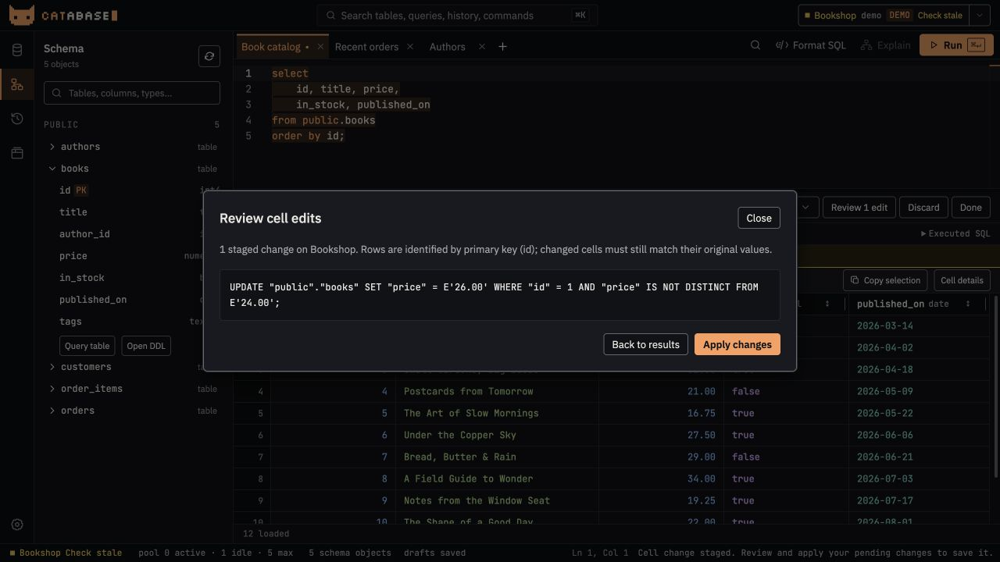

<p align="center">
  
</p>

<h1 align="center">Catabase</h1>

<p align="center">A desktop PostgreSQL workspace for writing SQL, exploring data, and reviewing changes.</p>

<p align="center">
  <a href="https://github.com/smolijar/catabase/actions/workflows/ci.yml"></a>
</p>

<p align="center">
  <a href="#install">Install</a> ·
  <a href="#features">Features</a> ·
  <a href="docs/usage.md">User guide</a> ·
  <a href="docs/development.md">Development</a>
</p>


*The real workspace UI, shown with fictional bookshop data.*

## Features

| | What you can do |
| --- | --- |
| **Write SQL with context** | Run a selection or the statement at the cursor. Find, replace and format SQL. Complete tables, aliases, columns and foreign-key joins from the reflected schema. |
| **Explore your database** | Browse schemas, tables and columns. Switch saved connections, check their health and distinguish environments with custom accents and labels. |
| **Work with results** | Inspect typed values, JSON and arrays. Resize columns, select ranges, copy cells and export CSV, TSV or JSON. Scroll to load another batch. |
| **Review edits** | Stage cell changes, pick foreign-key values and inspect generated SQL before applying. Rows are identified by primary/unique keys, with checks for stale values. |
| **Keep your workspace** | Save named query tabs and their connections. Reorder or duplicate tabs, reopen closed drafts and search across tabs, schema and history. |
| **Understand each run** | Reopen saved results and errors, expand transaction groups, inspect storage usage and see a detailed query-timing breakdown. Repeated SQL and identical snapshots share storage. |

Tuxedo, Snow and System themes, a resizable sidebar/results drawer, and editor-only font zoom let you adapt the workspace. Optional Supermaven ghost-text suggestions sit alongside local schema completion.



*Review a staged update before applying it. The original primary key identifies the row; the original changed value guards against stale edits.*

## Install

### macOS preview

Current downloads are **universal macOS previews** for Apple Silicon and Intel:

1. Open [CI builds](https://github.com/smolijar/catabase/actions/workflows/ci.yml) and choose a successful run on `main`.
2. Under **Artifacts**, download `Catabase-macos-universal-preview-…` and unzip it.
3. Open the included DMG and drag **Catabase** into **Applications**. An app ZIP is also included.

Artifacts require a GitHub login and expire after 14 days. Previews are ad-hoc signed, without Apple notarization, so macOS may block them. Signed public releases, a one-line installer and in-app updates are **not available yet**; see the [distribution guide](docs/distribution.md) for their setup and remaining work.

To verify the downloaded package files, run this from the extracted artifact folder:

```sh
shasum -a 256 -c SHA256SUMS
```

### Build from source

Install Rust/Cargo, Node.js 24+, pnpm, and the [Tauri prerequisites](https://v2.tauri.app/start/prerequisites/) for your platform. On macOS, this includes Xcode Command Line Tools.

```sh
git clone https://github.com/smolijar/catabase.git
cd catabase
pnpm install --frozen-lockfile
pnpm tauri build
```

On macOS, find the app and DMG under `target/release/bundle/`. Use `pnpm tauri dev` to run a development build. The repository pins its pnpm and Tauri CLI versions; use pnpm for dependency installation.

See [development](docs/development.md) for checks, universal builds and the code map. Current CI packages macOS; Windows and Linux downloads are not provided.

## Your first query

1. Add a PostgreSQL connection in **Connections**. Enter the password in its dedicated field; passwords pasted into the connection URL are ignored.
2. Click the connection to use it. Double-click opens its settings.
3. Write SQL in a query tab and press **Cmd/Ctrl+Enter**. A selection runs as selected; otherwise, the statement at the cursor runs.
4. Browse the result grid, or open **Cell details** to inspect a value. Enable **Edit cells** to stage changes when the result includes a usable primary or unique key.

The [user guide](docs/usage.md) covers connection options, transactions, editing, history and autocomplete.

## Keyboard shortcuts

| Shortcut | Action |
| --- | --- |
| `Cmd/Ctrl+Enter` | Run the selection or current statement |
| `Cmd/Ctrl+K` | Search tabs, schema, history and commands |
| `Cmd/Ctrl+F` | Find in the SQL editor |
| `Cmd/Ctrl+Alt+F` | Find and replace |
| `Cmd/Ctrl++` / `Cmd/Ctrl+-` / `Cmd/Ctrl+0` | Increase, decrease or reset editor font size |
| `Cmd/Ctrl+T` / `Cmd/Ctrl+W` | Open or close a query tab |
| `F2` | Rename a focused tab or edit a focused connection |

## Current limits

- Grid sorting applies to loaded rows. Explicit re-run exports are capped at 10,000 rows.
- Live results and staged edits are not restored after restart. History saves result snapshots up to 256 KiB; larger results retain SQL, timing and row count.
- Local SQLite state can contain SQL, result snapshots and fallback passwords. See [history and local data](docs/usage.md#history-and-local-data).
- Read-only connection defaults can be overridden by SQL; use PostgreSQL role permissions to enforce access restrictions.
- **Explain** is a placeholder. Optional Supermaven suggestions require a working upstream account and service.

## Project notes

Built with Rust, Tauri 2, Svelte 5 and Monaco.

- [User guide](docs/usage.md) — workspace behavior and shortcuts
- [Development](docs/development.md) — setup, checks and architecture
- [Distribution](docs/distribution.md) — preview builds, signing and releases
- [Issues](https://github.com/smolijar/catabase/issues) — bugs and feature requests
